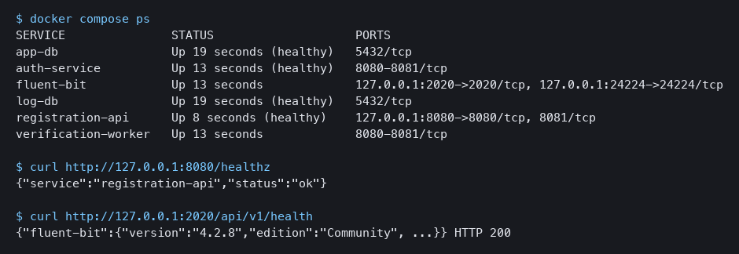
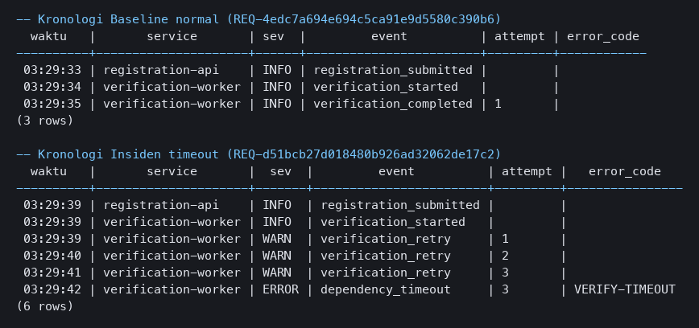
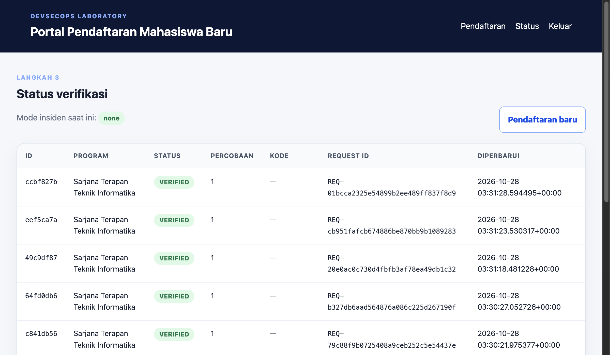

# BAB VI — CENTRALIZED LOGGING DENGAN FLUENT BIT DAN POSTGRESQL

**Nama:** Andi Rayka C · **NRP:** 3126640005 · **Kelas:** D4 LJ Informatika

## Pendahuluan

Laporan ini mengerjakan Bab 6 dengan skenario aplikasi PMB dari dosen (`lab/bab6/`): portal pendaftaran (`registration-api`), `auth-service`, dan `verification-worker` menulis log JSON ke `stdout`. Docker fluentd logging driver meneruskannya ke Fluent Bit 4.2.8, lalu disimpan ke PostgreSQL 16 (`logs.fluentbit`: `tag`, `time`, `data JSONB`). Tujuannya membuktikan alur normal, merekonstruksi insiden *dependency timeout* hanya dari log terpusat, dan menguji ketahanan pipeline saat database log mati.

> *Pernyataan penggunaan AI:* bagian ini ditulis dengan bantuan asisten AI (Amp, model Claude) berdasarkan materi Bab 6 dan paket lab dosen. Isi ringkasan tujuan bersumber dari dokumen tersebut.

## Dasar Teori

Container bersifat sementara, sehingga log yang tertinggal di container hilang bersama container. Centralized logging memindahkan log ke satu penyimpanan yang dapat dicari dan dikorelasikan [1][3]. Fluent Bit menerima record melalui input *forward*, menahannya pada buffer filesystem, dan mengirimnya ke output `pgsql` [2][4]. Kunci korelasi lintas service adalah `request_id`, sehingga satu transaksi dapat ditelusuri dari API ke worker. Menyimpan data sebagai JSONB membuat field dapat di-query, tetapi `data.log` tetap berupa string JSON dari aplikasi sehingga perlu di-*cast*.

> *Pernyataan penggunaan AI:* ringkasan teori disusun dengan bantuan AI dari materi bab dan dokumentasi Fluent Bit/Docker yang tercantum pada Daftar Pustaka.

## Pelaksanaan Praktikum

> *Pernyataan penggunaan AI:* seluruh perintah di bagian ini dijalankan dan dicatat oleh asisten AI (Amp) pada Colima/Docker di laptop saya atas instruksi saya; saya tidak mengetik perintahnya sendiri. Hasil di bawah adalah keluaran asli, bukan karangan.

Paket lab disalin ke `lab/bab6/`, `./scripts/setup.sh` membuat `.env` dengan credential acak, dan `./scripts/validate.sh` lulus (3 unit test redaction/request ID, `docker compose config`). Skenario dijalankan berurutan: **A** baseline (`demo-normal.sh`), **B** mode `timeout` (`demo-incident.sh`), **C** pemulihan (`set-incident.sh none` lalu transaksi baru), **D** `log-db` dihentikan saat transaksi berjalan. Evidence mentah ada di `evidence/bab6/`.

**Masalah yang muncul dan diagnosisnya.** Setelah `docker compose up`, enam container sehat tetapi `curl 127.0.0.1:8080` dan `:2020` ditolak, dan `docker compose ps` tidak menampilkan pemetaan port. Pemeriksaan `docker network inspect` menunjukkan `app-net` dan `logging-net` berstatus `internal=true`; jaringan internal Docker tidak mendukung *published port*. Akibatnya portal tidak terjangkau dan Docker Engine tidak bisa mengirim log ke `127.0.0.1:24224`. Perbaikan minimal (`evidence/bab6/compose-fix.diff`): menambah jaringan `edge-net` non-internal hanya pada `registration-api` dan `fluent-bit`; kedua database tetap pada jaringan internal. Selain itu, `setup.sh` (`sed -i`) dan `lib.sh` (`awk IGNORECASE`) disesuaikan agar berjalan di macOS.

## Hasil dan Pembahasan

> *Pernyataan penggunaan AI:* kueri SQL dijalankan dan hasilnya dianalisis dengan bantuan AI; angka pada tabel disalin dari `evidence/bab6/03`–`06`, dan saya yang bertanggung jawab atas kesimpulannya.

**Kronologi per `request_id`.** Seluruh 87 record awal berasal dari tiga tag (`registration-api` 57, `auth-service` 20, `verification-worker` 10), bertipe `jsonb`. Kueri korelasi memisahkan transaksi normal dan insiden:

| Tahap | Hasil | Interpretasi |
|---|---|---|
| A Baseline | `registration_submitted` → `verification_started` → `verification_completed`, 2 detik; status `VERIFIED` | Alur sehat; dasar pembanding |
| B Timeout | 3× `verification_retry` (WARN), lalu `dependency_timeout` (ERROR, `VERIFY-TIMEOUT`); status `FAILED`, attempt 3 | Service pertama yang menghasilkan WARN/ERROR adalah `verification-worker`; API dan auth tetap INFO |
| C Recovery | Mode `none`, transaksi baru `VERIFIED` | Sistem pulih; transaksi lama tetap `FAILED` karena tidak diproses ulang otomatis |
| Secret | Kueri `password\|authorization\|bearer\|cookie\|session…` = 0 temuan; `verify.sh` PASS | Tidak ada credential di log |

Status container `Up` ternyata tidak cukup: pada tahap B semua container sehat, padahal pendaftaran gagal. Hanya log terpusat yang menunjukkan penyebabnya.

**Ketahanan logging (Tahap D).** Saat `log-db` dihentikan dan tiga transaksi dikirim, Fluent Bit mencatat `failed to flush chunk ... retry` dan tetap berjalan. Setelah `log-db` hidup lagi jumlah record naik 93 → 108, tetapi tidak lengkap: dari 9 event bisnis (3 per transaksi) hanya 2 tiba, dan metrik `pgsql.0` mencatat `retries_failed: 16`, `dropped_records: 42`. Kenaikan record sendiri belum membuktikan tidak ada yang hilang. Penyebabnya `Retry_Limit` bawaan Fluent Bit yang bernilai 1 [4], sehingga chunk dibuang setelah retry gagal. Setelah `Retry_Limit no_limits` ditambahkan (`fluent-bit-fix.diff`) dan tes diulang, `dropped_records` menjadi 0 dan 8 dari 9 event tiba. Satu event tetap tidak ditemukan; penyebabnya belum terbukti (kandidat: event yang sedang dikirim driver Docker saat container Fluent Bit dibuat ulang), sehingga hasil ini bukan jaminan *exactly-once* maupun *no-loss*.

**Risiko dan rekomendasi production-like.** (1) Retry tanpa batas dan buffer 256 MB bisa memenuhi disk; tetapkan `storage.total_limit_size` dan alert pada metrik `dropped_records`/`retries_failed`. (2) Credential database di environment Compose terlihat lewat `docker inspect`; gunakan secret manager. (3) Tanpa TLS antar-komponen dan `SESSION_COOKIE_SECURE` mati; wajibkan TLS dan HTTPS. (4) Tambahkan `event_id` agar duplikasi hasil retry bisa dideteksi, serta kebijakan retensi dan akun analyst read-only.

## Kesimpulan

Pipeline Docker fluentd driver → Fluent Bit → PostgreSQL JSONB berfungsi dan cukup untuk merekonstruksi insiden `VERIFY-TIMEOUT` hanya dari log dengan `request_id`. Dua cacat nyata ditemukan dan diperbaiki: jaringan `internal` yang memblokir port, dan `Retry_Limit` bawaan yang membuang log saat backend mati. Satu event tetap hilang pada uji ulang, sehingga pipeline ini layak untuk lab, belum untuk evidence kritis tanpa pengamanan tambahan.

> *Pernyataan penggunaan AI:* kesimpulan dirumuskan dengan bantuan AI dari hasil yang tercatat di atas.

## Evaluasi dan Latihan Mandiri

**Evaluasi.** (1) Event pada periode kegagalan collector/backend dapat hilang; terbukti 7 dari 9 event hilang sebelum `Retry_Limit` diubah. (2) Log terstruktur punya field konsisten yang bisa di-filter dan di-JOIN per `request_id` tanpa regex rapuh pada teks. (3) PostgreSQL tidak lagi cocok bila volume ingest sangat besar, retensi panjang, atau pencarian teks penuh dominan; pertimbangkan Loki, OpenSearch, atau ClickHouse. (4) Log observability dipakai untuk diagnosis dan boleh disampling/dibuang; log forensik harus lengkap, tak dapat diubah, dan diberi checksum. (5) Kueri per menit: `SELECT date_trunc('minute', time) AS menit, count(*) FROM logs.fluentbit WHERE time >= now() AT TIME ZONE 'UTC' - interval '10 minutes' GROUP BY 1 ORDER BY 1 DESC;`. Hasil aktual: 84 record pada 03:29 dan 3 pada 03:30 (`evidence/bab6/03`).

**Latihan mandiri.** (1) `request_id` sudah ada pada tiap event; satu transaksi ditelusuri dengan `WHERE ev->>'request_id' = '…'` (Gambar 6.2). (2) Isi `data.log` di-*cast* ke JSONB hanya bila diawali `{`, sehingga baris non-JSON tidak membuat kueri error. (3) Redaction diuji oleh unit test `test_sensitive_fields_are_redacted` (lulus) dan kueri secret = 0; canary token ke pipeline belum saya uji. (4) Setelah perbaikan, input Fluent Bit menerima 141 record dan output memproses 141 (*dropped* 0). Sebelum perbaikan input menerima 153, tersimpan 108, *dropped* 42; selisih 3 record belum saya jelaskan. Jumlah yang dihasilkan aplikasi tidak saya hitung dari sumbernya, sehingga satu event yang hilang sebelum input Fluent Bit tidak terlihat pada perbandingan ini. (5) Retensi: hapus per batch `DELETE FROM logs.fluentbit WHERE time < now() - interval '7 days'` terjadwal; untuk skala besar, partisi harian lebih baik. Pratinjau kandidat hapus = 0 baris. (6) PostgreSQL cocok untuk lab karena mudah dikueri dan dipahami, tetapi telemetry berukuran sangat besar membebani indeks GIN, *vacuum*, dan biaya penyimpanan.

## Daftar Pustaka

1. Fluent Bit, “PostgreSQL output.” [https://docs.fluentbit.io/manual/data-pipeline/outputs/postgresql](https://docs.fluentbit.io/manual/data-pipeline/outputs/postgresql)
2. Fluent Bit, “Buffering.” [https://docs.fluentbit.io/manual/data-pipeline/buffering](https://docs.fluentbit.io/manual/data-pipeline/buffering)
3. Docker, “Fluentd logging driver.” [https://docs.docker.com/engine/logging/drivers/fluentd/](https://docs.docker.com/engine/logging/drivers/fluentd/)
4. Fluent Bit, “Scheduling and retries.” [https://docs.fluentbit.io/manual/administration/scheduling-and-retries](https://docs.fluentbit.io/manual/administration/scheduling-and-retries)
