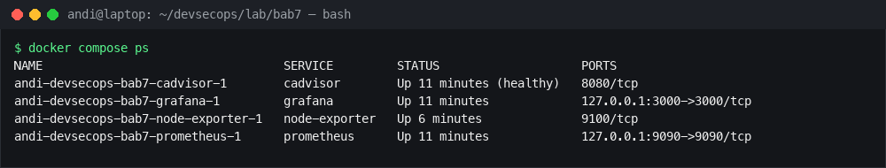
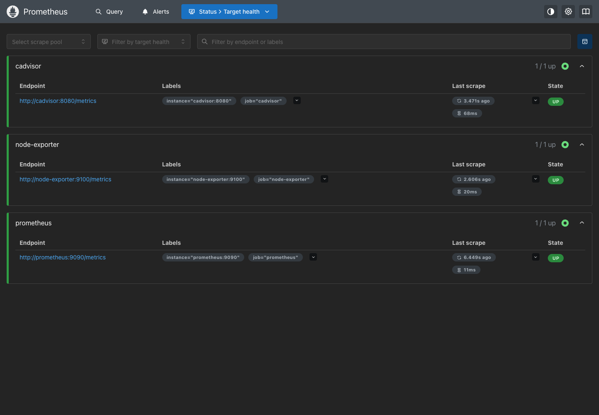
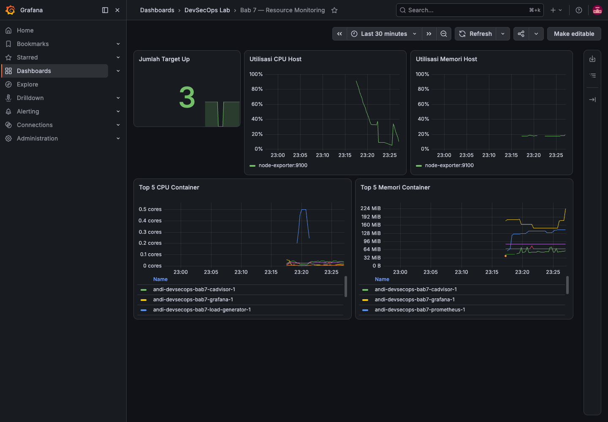

# BAB VII — MONITORING RESOURCE DENGAN PROMETHEUS, CADVISOR, NODE EXPORTER, DAN GRAFANA

**Nama:** Andi Rayka C · **NRP:** 3126640005 · **Kelas:** D4 LJ Informatika

## Pendahuluan

Laporan ini mengerjakan Bab 7 dengan skenario monitoring resource dari dosen (`materi/bab-07.md` dan `materi/cheatsheets/bab-07-cs.md`): Prometheus meng-*scrape* metrik host dari Node Exporter dan metrik container dari cAdvisor, lalu Grafana menyajikannya dalam dashboard yang diprovisi sebagai kode. Tujuannya membuktikan target scrape sehat, memvalidasi recording/alert rule, mengamati beban CPU dari generator, dan menguji alert `TargetDown` lewat kegagalan yang disengaja.

> *Pernyataan penggunaan AI:* bagian ini ditulis dengan bantuan asisten AI (Amp, model Claude) berdasarkan materi Bab 7 dan cheatsheet dosen. Isi ringkasan tujuan bersumber dari dokumen tersebut.

## Dasar Teori

Monitoring menjawab “apa yang terjadi” lewat angka time-series, sedangkan logging menjawab “mengapa” lewat event [1]. Prometheus memakai model *pull*: server mengunjungi endpoint `/metrics` target secara berkala (di sini 15 detik) dan menyimpan sample ber-label [2]. Grafana tidak menyimpan metrik utama; ia meng-query data source Prometheus untuk visualisasi. `rate()` diperlukan untuk counter karena nilai mentah counter selalu naik: `node_cpu_seconds_total{mode="idle"}` saya baca sekitar 1214 detik dan terus bertambah, sedangkan `rate(...[5m])` stabil di sekitar 0,947 per detik per core. Kesalahan pemula adalah membaca counter mentah tanpa `rate()` sehingga grafik tampak naik terus [1].

Setiap time series dibentuk oleh nama metrik dan label. Label seperti `instance`, `job`, dan `name` membantu segmentasi; memasukkan nilai berdimensi tinggi (user ID, request ID) sebagai label menaikkan cardinality dan memboroskan memori/storage [1][2]. cAdvisor mengekspos metrik container, Node Exporter mengekspos metrik host; keduanya menjawab level pertanyaan yang berbeda.

> *Pernyataan penggunaan AI:* ringkasan teori disusun dengan bantuan AI dari materi bab dan dokumentasi Prometheus/Grafana yang tercantum pada Daftar Pustaka.

## Pelaksanaan Praktikum

> *Pernyataan penggunaan AI:* seluruh perintah di bagian ini dijalankan dan dicatat oleh asisten AI (Amp) pada Colima/Docker di laptop saya atas instruksi saya; saya tidak mengetik perintahnya sendiri. Hasil di bawah adalah keluaran asli, bukan karangan.

Paket lab diadaptasi ke `lab/bab7/`. `scripts/create-env.sh` membuat `.env` dengan password acak (mode 600), lalu `docker compose up -d` menyalakan empat service: Prometheus, Grafana, Node Exporter, dan cAdvisor. Hanya Prometheus (`127.0.0.1:9090`) dan Grafana (`127.0.0.1:3000`) yang dipublikasikan ke loopback; endpoint exporter hanya dapat dijangkau Prometheus lewat jaringan internal `bab7-monitoring-net`.

`./scripts/verify-stack.sh` memeriksa kesiapan Prometheus dan Grafana, tiga target berstatus `up`, empat query PromQL, serta `promtool check config/rules`; semuanya lulus. `promtool test rules` untuk alert `TargetDown` mengembalikan `SUCCESS`. Skenario dijalankan berurutan: **A** baseline dan PromQL, **B** beban CPU (`load-generator`, `cpus: 0.50`), **C** *negative test* `TargetDown` dengan menghentikan `node-exporter`, **D** pemulihan. Evidence mentah ada di `evidence/bab7/`.

**Masalah yang muncul dan diagnosisnya.** Jalankan pertama `verify-stack.sh` gagal dengan `Target up=0, down=0` padahal Prometheus sudah siap. Pemeriksaan `/api/v1/targets` menunjukkan ketiga target berstatus `health: "unknown"` dan `lastScrape` masih kosong: interval scrape 15 detik belum berlalu, sehingga belum ada scrape pertama. Skrip asli memeriksa target segera setelah endpoint HTTP siap. Perbaikan minimal (`evidence/bab7/` tercermin pada `scripts/verify-stack.sh`): menambahkan loop tunggu yang memeriksa ulang `/api/v1/targets` hingga sedikitnya tiga target `up` sebelum menilai. Ini menegaskan bahwa `up=1` baru berarti endpoint berhasil discrape, bukan bahwa fungsi bisnis sehat.

## Hasil dan Pembahasan

> *Pernyataan penggunaan AI:* query PromQL dijalankan dan hasilnya dianalisis dengan bantuan AI; angka pada tabel disalin dari `evidence/bab7/03`–`06`, dan saya yang bertanggung jawab atas kesimpulannya.

**Baseline dan metrik.** Tiga target `up` (`prometheus`, `node-exporter`, `cadvisor`). Recording rule `instance:node_cpu_utilisation:ratio_rate5m` sempat 0,77 saat image ditarik dan turun ke sekitar 0,05 setelah beban reda; `instance:node_memory_utilisation:ratio` sekitar 0,18. `topk(5, container:cpu_usage_cores:rate1m)` menampilkan container bab7 dan stack lain yang sedang berjalan, membuktikan cAdvisor membaca runtime container.

| Skenario | Hasil | Interpretasi |
|---|---|---|
| A Baseline | `up` = 3 target; PromQL CPU/memori valid | Stack sehat; dasar pembanding |
| B Beban CPU | `load-generator` terukur 0,50 core (limit `cpus: 0.50`); `ALERTS{ContainerHighCPU}` `pending` | Limit cgroup berlaku dan rule menangkap saturasi |
| C Negative | `up{job="node-exporter"}` = 0; `ALERTS{TargetDown}` `firing` (severity `warning`) | Alert berubah state sesuai rancangan |
| D Pemulihan | `up{job="node-exporter"}` kembali 1 | Target pulih dalam satu-dua interval scrape |

Nilai CPU generator (~0,5 core) tidak boleh disamakan dengan persentase seluruh host: host VM punya beberapa core, sehingga 0,5 core setara porsi kecil dari kapasitas total. Inilah sebabnya alert container dan alert host memakai ekspresi berbeda (`core` vs `ratio`).

**Risiko dan rekomendasi production-like.** (1) cAdvisor berjalan `privileged: true` agar dapat membaca metadata runtime; pada produksi gunakan integrasi monitoring platform dan kurangi privilege. (2) Endpoint `/metrics` dapat membocorkan nama host, mount point, versi, dan pola beban; jangan publikasikan exporter langsung ke jaringan publik, tambahkan autentikasi/TLS atau proxy. (3) Password admin Grafana disimpan di environment Compose dan terbaca lewat `docker inspect`; gunakan secret manager dan rotasi credential. (4) Datasource PostgreSQL (integrasi log Bab 6) dibiarkan opsional dan berstatus gagal sampai stack Bab 6 dihubungkan; tanpa itu, korelasi metrik ke log tidak tersedia.

## Kesimpulan

Stack Prometheus → Node Exporter/cAdvisor → Grafana berfungsi dan cukup untuk mengamati metrik host serta container, memvalidasi rule, dan membuktikan alert `TargetDown` berubah dari `pending` ke `firing` saat target benar-benar mati. Satu cacat nyata ditemukan dan diperbaiki: pemeriksaan target yang terlalu dini pada skrip verifikasi, karena target belum discrape. Monitoring ini menjadi kontrol detektif yang dapat dipercaya untuk lab, namun belum untuk produksi tanpa pengamanan akses exporter dan pengurangan privilege cAdvisor.

> *Pernyataan penggunaan AI:* kesimpulan dirumuskan dengan bantuan AI dari hasil yang tercatat di atas.

## Evaluasi dan Latihan Mandiri

**Evaluasi.** (1) Prometheus memakai model *pull* agar server mengendalikan jadwal dan target, sehingga healthcheck scrape menyatu dengan pengumpulan; push cocok bila target berumur pendek atau berada di balik NAT. (2) `scrape_interval` terlalu kecil menaikkan jumlah sample, trafik, CPU scraper, dan storage TSDB; interval 15 detik memadai untuk lab, bukan angka universal produksi. (3) `rate()` diperlukan karena counter hanya bertambah; nilai mentah `node_cpu_seconds_total` (~1214 detik) tidak merepresentasikan throughput, sedangkan `rate(...[5m])` ≈ 0,947/s stabil dan bermakna. (4) Indikator awal memory pressure: `node_memory_MemAvailable_bytes` menurun, `container_memory_working_set_bytes` mendekati limit, `cgroup` OOM kill/restart, dan `container_memory_failures_total` naik. (5) Alert metrik dihubungkan ke log lewat waktu dan label bersama: tampilkan rentang waktu alert di Grafana, lalu cari log Bab 6 pada jendela yang sama menggunakan `$__timeFilter(time)`; korelasi waktu saja belum membuktikan sebab-akibat.

**Latihan mandiri.** (1) Saya membandingkan recording rule `instance:node_cpu_utilisation:ratio_rate5m` dengan ekspresi langsung `1 - avg(rate(node_cpu_seconds_total{mode="idle"}[5m]))`; hasilnya setara, dan rule menghemat penulisan query berulang. (2) Saya tidak mengubah `scrape_interval`, tetapi mengamati bahwa sebelum scrape pertama target berstatus `unknown` — bukti bahwa resolusi menentukan seberapa cepat keadaan terlihat. (3) Alert `TargetDown` saya uji lewat kegagalan nyata (menghentikan `node-exporter`) dan `promtool test rules`; keduanya lulus, sesuai lapisan “rule benar” dan “rule berubah state”. (4) Dari `topk(5, container:cpu_usage_cores:rate1m)` terlihat label `name` container berubah setiap recreate; untuk produksi pakai label service yang stabil. (5) Panel network tidak saya tambahkan, tetapi ekspresinya `rate(node_network_receive_bytes_total[5m])` dapat langsung dipakai pada Node Exporter. (6) Kenaikan CPU `load-generator` dan log Bab 6 tidak saya korelasikan karena integrasi PostgreSQL opsional belum dijalankan. (7) SLI sederhana yang saya tetapkan untuk lab: proporsi target `up=1` (availability), bukan CPU host — karena CPU tinggi bisa jadi beban produktif, sedangkan target down langsung menggagalkan scraping.

## Daftar Pustaka

1. Ferryas PENS, [Materi DevSecOps Bab 7: Monitoring Resource](https://github.com/ferryas-pens/devsecops/blob/main/bab-07.md).
2. Ferryas PENS, [Cheatsheet Bab 7: Prometheus, cAdvisor, Node Exporter, dan Grafana](https://github.com/ferryas-pens/devsecops/blob/main/cheatsheets/bab-07-cs.md).
3. Prometheus Authors, [Configuration](https://prometheus.io/docs/prometheus/latest/configuration/configuration/) dan [Query functions](https://prometheus.io/docs/prometheus/latest/querying/functions/).
4. Grafana Labs, [Provisioning](https://grafana.com/docs/grafana/latest/administration/provisioning/).

> *Pernyataan penggunaan AI:* AI membantu saya menemukan dan memeriksa tautan sumber. Saya memverifikasi bahwa tautan merujuk dokumentasi resmi.
